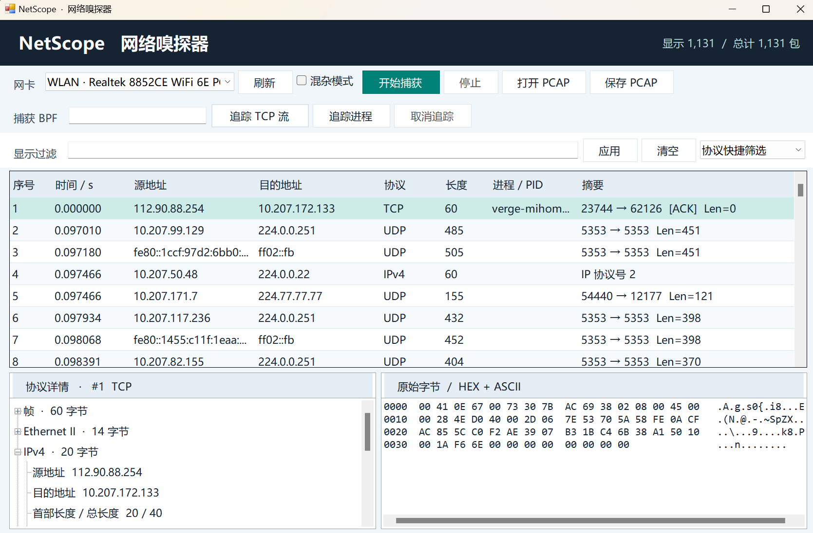
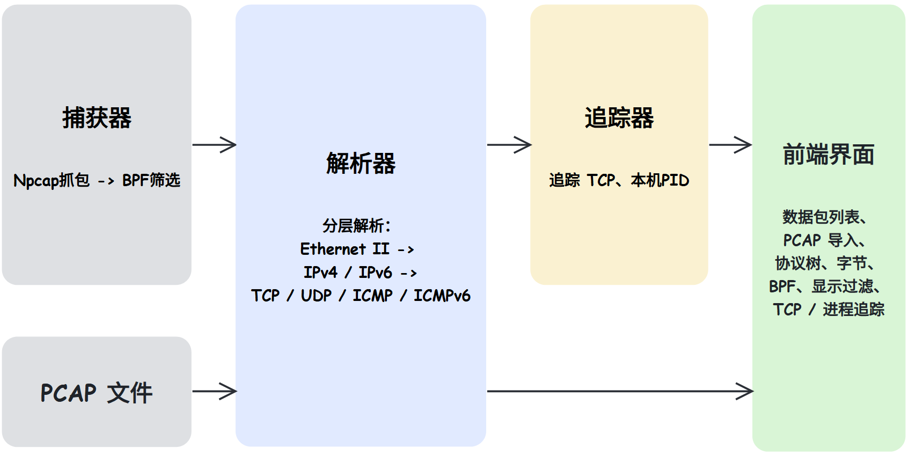
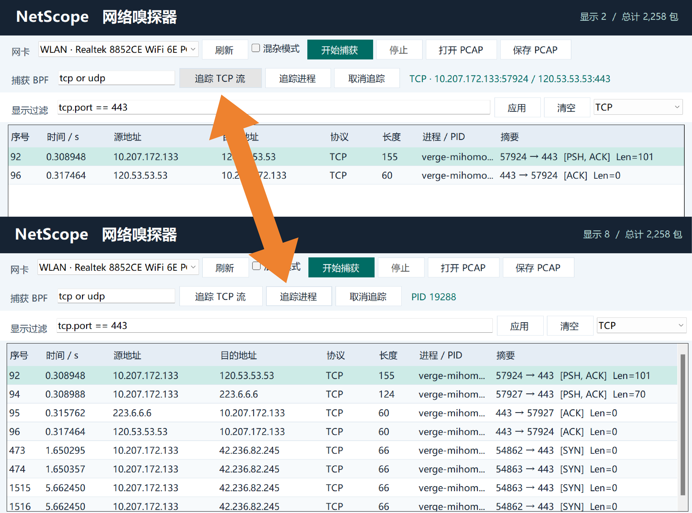

# 1. 项目概述

本实验使用 C# 和 .NET Framework 4.8 开发了 Windows 网络嗅探器 NetScope，采用 WinForms 编写图形界面，并通过 Npcap 实时捕获网络报文。

支持功能：常见协议解析、BPF 捕获过滤、显示过滤、TCP 追踪、本机进程追踪，以及 PCAP 文件的读取和保存。

#### 源码文件说明

`src` 目录包含 7 个 C# 源文件和 4 个构建与配置文件。

| 文件                 | 代码内容                                             |
| ------------------ | ------------------------------------------------ |
| `Program.cs`       | 程序入口，初始化 WinForms 并打开主窗口。                        |
| `MainForm.cs`      | 构建主界面，处理抓包、筛选、追踪等操作，更新报文列表、协议树和字节视图。             |
| `Capture.cs`       | 调用 Npcap 枚举网卡、安装 BPF 过滤条件并读取实时报文。                |
| `Packet.cs`        | 定义报文数据结构，逐层解析报文首部，生成双向 TCP 流的标识。                 |
| `DisplayFilter.cs` | 解析显示过滤表达式，按协议、地址、端口或 PID 匹配报文。                   |
| `TcpOwners.cs`     | 查询 Windows TCP 连接表，根据 IP 和端口为实时捕获的 TCP 报文关联本机进程。 |
| `PcapFile.cs`      | 读取和保存 `.pcap` 文件。                                |
| `NetScope.csproj`  | 项目配置，包括目标框架、平台和构建设置等。                            |
| `build.ps1`        | 构建生成 `exe` 文件。                                   |
| `App.config`       | 声明 .NET Framework 运行环境和 WinForms 高 DPI 设置。       |
| `app.manifest`     | 声明 Windows 兼容性、运行权限和 DPI 感知模式。                   |

# 2. 核心功能

实现了基本完整的网络嗅探器功能，并且还实现了较丰富的分析功能。

#### 2.1 报文捕获

NetScope 通过 Npcap 获取网卡上的原始报文。程序用 `pcap_findalldevs` 枚举网卡，再用 `pcap_open_live` 打开选中的网卡。用户可以选择普通网卡或本机回环，也可以在开始前开启混杂模式。

报文捕获可以选择捕获全部报文，也可以填写捕获 BPF，从而只捕获特定报文。

填写捕获 BPF 后，`Capture.cs` 调用 `pcap_compile` 编译表达式，再用 `pcap_setfilter` 安装到这次捕获的句柄上。后台线程用 `pcap_next_ex` 读取符合条件的报文，被 BPF 排除的包不会进入列表。

#### 2.2 协议解析

`Packet.cs` 从原始字节逐层读取首部。以太网帧根据 EtherType 判断下一层，IPv4 按首部长度找到传输层，IPv6 沿 Next Header 检查扩展头。随后按协议读取 TCP、UDP、ICMP 或 ICMPv6 字段。以太网帧也可以解析 VLAN 和 ARP。

TCP 的数据偏移字段给出载荷起点。程序检查该处是否出现完整的 HTTP/1.0 或 HTTP/1.1 请求行、状态行，例如 `GET / HTTP/1.1`，并读取本段内完整的首部行。HTTP 识别以当前 TCP 段为单位。

能解析的协议如下：

| 层次  | 协议                   |
| --- | -------------------- |
| 链路层 | Ethernet II、VLAN     |
| 网络层 | IPv4、IPv6、ARP        |
| 传输层 | TCP、UDP、ICMP、ICMPv6  |
| 应用层 | 明文 HTTP/1.0、HTTP/1.1 |

用户还可以像在 wireshark 里一样手动输入显示过滤的条件。

`DisplayFilter.cs` 把用户输入解析成针对单个报文的布尔条件。协议、地址、端口和 PID 都来自已解析的数据。过滤发生在界面更新时，程序保留原始报文集合。实时结果经队列交给界面，每 100 ms 批量更新。

#### 2.3 TCP 流、本机进程追踪

TCP 流使用两个 `IP:端口` 端点作为键。程序按固定顺序排列这两个端点，请求和响应就会得到相同的键，追踪时按键筛选双向报文。若一对端点在同次捕获中被复用，对应报文会归入同一组。

`TcpOwners.cs` 在实时捕获期间定期用 Windows 的 `GetExtendedTcpTable` 读取 IPv4 和 IPv6 TCP 连接表，再按报文两端的 IP 和端口查找 PID。回环连接的两端如果分属不同进程，可以按任一端 PID 筛选。

# 3. 操作指南

#### 3.1 主要操作

1. 在首行选择网卡。抓本机 `127.0.0.1` 或 `::1` 的流量时，选择本机回环。
2. 如需限定捕获范围，先填写捕获 BPF，再点开始捕获。更改 BPF 需要先停止再更改，再重新开始捕获。
3. 点选一行报文。左下方显示协议字段，右下方显示原始字节；点协议节点可定位该层的首字节。
4. 保存 PCAP 可导出这次保留的全部报文。打开 PCAP 可离线分析 `.pcap` 文件。
5. 选择 TCP 报文后可追踪 TCP 流；实时捕获中，选中带 PID 的报文后可追踪进程。当前显示过滤会继续生效。点取消追踪可退出追踪。

#### 3.2 捕获 BPF 支持的逻辑

捕获 BPF 使用 Npcap 的 `pcap-filter` 语法。留空即可跳过 BPF 筛选。在该输入框中，`ip` 匹配 IPv4，`ip6` 匹配 IPv6，`icmp` 与 `icmp6` 分别匹配两种 ICMP。ARP 适用于以太网等能看到 ARP 的链路。

| 类型    | 输入示例                                                            | 匹配范围                     |
| ----- | --------------------------------------------------------------- | ------------------------ |
| 协议    | `tcp`、`udp`、`ip`、`ip6`、`icmp`、`icmp6`、`arp`                     | 选择协议类型                   |
| 地址与方向 | `host 192.0.2.20`、`src host 192.0.2.10`、`dst host 2001:db8::20` | 任一端、源端或目的端地址             |
| 网段    | `net 192.0.2.0/24`                                              | 任一端落在指定网段                |
| 端口与范围 | `tcp port 8080`、`udp dst port 53`、`tcp portrange 8000-8100`     | 指定端口、方向或端口范围             |
| 组合    | `(tcp port 8080 or udp port 53) and not host 192.0.2.10`        | 用 `and`、`or`、`not` 和括号组合 |

#### 3.3 显示过滤支持的逻辑

显示过滤使用类似 wireshark 的语法，留空即显示全部报文。语法错误会弹窗提示，上一条有效条件继续生效。

| 类型    | 输入示例                                                                    | 匹配范围                                                           |
| ----- | ----------------------------------------------------------------------- | -------------------------------------------------------------- |
| 协议    | `http`、`tcp`、`udp`、`ipv4`、`ipv6`、`icmp`、`icmpv6`、`arp`                  | `ip` 等同于 `ipv4`。 `icmp` 包含 ICMPv6。 `tcp` 也包含识别为 HTTP 的 TCP 报文。 |
| IP 地址 | `ip.addr == 192.0.2.20`、`ip.src == 192.0.2.10`、`ip.dst == 2001:db8::20` | 源端或目的端 IP，支持 IPv4 和 IPv6                                       |
| 端口    | `tcp.port == 443`、`udp.port == 53`                                      | 源端口或目的端口，范围 0–65535                                            |
| 进程    | `pid == 1234`                                                           | 已关联该本机 PID 的 TCP 报文                                            |
| 组合    | `(http or udp) and not ipv6`                                            | 支持 `not`、`and`、`or`，优先级递减。                                     |

# 4. 使用方式

可以直接运行 `NetScope.exe` 文件，也可以从源码构建。

#### 4.1 直接运行 `exe` 文件

`bin` 中提供了可直接运行的 `exe` 文件，及其 `config` 配置文件。

运行需要 .NET Framework 4.8 环境，一般 windows 系统即满足此需求
实时抓包依赖 Npcap，因此运行需要先安装 Npcap。
不过即使不安装 Npcap，也可以导入本地的 PCAP 文件进行报文分析。

#### 4.2 从源码构建

从源码构建需安装 .NET SDK 8 或以上版本及 .NET Framework 4.8 Developer Pack。

构建文件已写好，执行 `.\src\build.ps1`，即在 `bin` 中生成 `exe` 文件。
